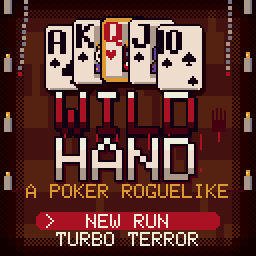

# Wild Hand

A horror poker roguelike for [CHGame](https://github.com/bateske/CHGame), the 128x128 handheld. Each night a monster
dealer deals you eight cards. Play poker hands to reach the night's goal, spend your winnings in the crypt shop on wild
cards that bend the scoring, and survive eight nights to win the run.

## Install

1. Copy `WILDHAND.DAT` to the root of the SD card, next to the `GAMES` folder.
2. Copy `WILDHAND.CHG` into `GAMES/GAMES` and start it from the menu.

The pictures and songs are streamed from `WILDHAND.DAT`; without it the game shows `NEED WILDHAND.DAT`. The game and
the DAT are built as a pair and a DAT from another build is refused, so update both together. Copying a new DAT resets
the settings kept in its last block.

## Controls

| Control | Action |
|---|---|
| LEFT / RIGHT | Move along the hand (hold to run); UP / DOWN move in the shop |
| A | Pick up or drop the card under the cursor (up to five) |
| B | Play the picked cards |
| UP | Discard the picked cards |
| DOWN | Hand levels table |
| START | Pause menu |
| START (hold 3 s) | Back to the CHGame menu |

## Rules

- Eight nights with goals of 300, 450, 700, 1,000, 1,600, 2,500, 4,000 and 7,000, then endless mode (each goal half
  as big again).
- Each night gives four plays and three discards. A hand scores its chips times its multiplier, plus the chips of each
  scoring card. A run ends when you are out of plays short of the goal.
- Hands, weakest to strongest: high card, pair, two pair, three of a kind, straight, flush, full house, four of a
  kind, straight flush. Every play of a hand type levels it up.
- Every third night is a **hex** with a twist: a dead suit, cards dealt face down, three plays, no discards, or at most
  four cards a hand. Beating a hex pays $5 more.

### Dealers

| Dealer | Edge |
|---|---|
| BEHOLDER | Shows the next card of the deck |
| MIMIC | One more discard |
| DRAGON | +$1 for every hand played |
| MIND FLAYER | A pair in your first hand |
| CUBE | +$4 when you win the night |
| LICH | +10 chips on every hand |

### Wild cards

The crypt shop offers three of 24 wild cards at a time; you can hold three. Some pairs form combos: RED RITE, BLACKOUT,
DAMNED and DEAD KINGS.

### Bonus stages

A bonus stage opens every run and follows every hex night. A trick reveals the prize (big money, a free wild card, or x2
on the next night's hands), then you take on a stage or flee. Losing costs half your money and a play on the next night.
There are twelve stages: THE CHASE, HIGH OR LOW, THE DUEL, GRAVES, SEANCE, GALLOWS, DEAD WHEEL, RAVEN RAIN, GHOULS,
THE COUNT, THE WATCHER and BLACKJACK DASH (A hit, B stand, UP double, DOWN split). From the title, BONUS plays any of
them and BLACKJACK plays Blackjack Dash on its own.

### Turbo terror

Sixty seconds, two random wild cards and unlimited plays. Milestones add time. The best score is saved.

## Pause menu and saving

MUSIC, EFFECTS (full or calm), CARD size, INDEX size, SONG, EQ, card colours (eight themes, including colour-blind
presets, or face, suit, highlight and accent individually; every combination keeps a 4.5:1 contrast), animated
backdrops (BG), SAVE GAME and QUIT TO TITLE. The game saves when a shop opens and from the pause menu; the title
offers CONTINUE when a save exists. Settings are also kept in the DAT's last block so they survive another game using
the save page.

## Building

Requires the CHGame board package and a CHGame board (or the simulator in `chgame/`). From this folder:

    python CHWildHand/tools/make_music.py
    python CHWildHand/tools/make_card.py   # WILDHAND.DAT and its headers
    ./cl build
    ./cl upload

`./cl check` runs the simulator scripts and size checks.

## Source layout

| File | Contents |
|---|---|
| `CHWildHand.ino` | State, input, title and save |
| `Rules.h` | Wild cards, combos, hand levels, hexes, endless, turbo |
| `Gfx.h`, `Scene.h` | Table drawing, gore, backdrops, parallax |
| `Dealers.h` | The monster dealers |
| `Bonus.h`, `Minis.h`, `StageVM.h` | Bonus show, stage select, pause menu, bonus stages and the script VM |
| `Card.cpp` | SD card reader and block cache |
| `Synth.cpp`, `Sounds.cpp` | Music and sound effects |
| `tools/` | Generators for art, music and text; stage scripts (`tools/stages`); simulator scripts and tests |

Debug commands for simulator scripts (`say`): H heat, W win, O over, X shop, R round, M money, J wild cards, G bonus
show, Z bonus stage, U turbo, D dealer, Y hex twist, I hand levels, F effects, C card size, E time left, V power cycle.

## Licence

Code, art and songs are MIT, by Jadflat (see `LICENSE`). Built on [CHGame](https://github.com/bateske/CHGame) by
Kevin Bates (bateske), Apache-2.0, vendored unchanged in `chgame/`. See `THIRD-PARTY.md` and `NOTICE`.
